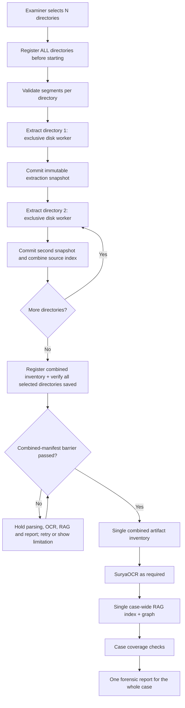

# Polaron multi-directory disk evidence case — 10 November 2026

## Required behavior

One examiner case/job accepts **multiple source directories**, each containing a separate disk image group (for example, `/case/source-A/image.E01` + `image.E02` and `/case/source-B/image.E01` + `image.E02`). Split segments are kept together **within** their own directory; identical filenames across directories never cause the images to be treated as one split set.



## Implementation

- `backend/app/services/next_evidence_directory.py`: directory grouping, exclusive append lease, immutable combined index, extraction roster, `combined_handoff_ready` fail-closed predicate, explicit barrier when the first snapshot is not published.
- `backend/app/services/disk.py`: refuses post-extract artifact/RAG handoff until the append step finishes, all registered source directories are present in the combined saved manifest and artifact registration is complete. When held, status stays `disk_ready` and 99% rather than pretending the job is complete.
- `backend/app/routers/jobs.py`: a resumed `disk_ready` case refuses downstream work for **any** pending directory reason (not just the former specific message).
- `backend/app/tasks.py`: direct RAG jobs also honor the directory extraction gate.
- `backend/app/services/process_completion.py`: direct report-generation requests refuse incomplete combined extraction, even if earlier stage status appears terminal.
- `backend/app/services/forensic_serial_pipeline.py`: publishes `directory_merge` status and one-report scope alongside the existing per-source directory roster.
- `frontend/src/components/forensic/SerialPipelineBanner.tsx` and `JobProgressBanner.tsx`: per-directory state, segments, counts, saved tally, merge indicator, and a clear statement that artifact inventory, RAG and reporting are shared once per case.
- `frontend/src/lib/types/forensic.ts`: typed merge status.

### UI state

- Directory 1: `Extracting`, then `Saved`; later directories: `Waiting` until predecessor is saved.
- UI shows `X / N saved`, source path, segment count, file count, and an `Extracting / Merge pending / Merged` status.
- RAG and artifact parsing are held until final registration succeeds. One report belongs to **the same case job ID**.
- `100%` processing is not a claim of full source recovery. Missing/corrupt/encrypted evidence and source limits must be separately reported.

## Regression validation

Run from `backend`:

```bash
PYTHONPATH=. pytest -q \
  tests/test_multi_directory_combined_barrier_20261110.py \
  tests/test_next_evidence_directory_20261023.py \
  tests/test_segment_readiness_scope_20261102.py
```

20 focused tests passed in the offline environment. Backend Python compilation passed. Live acquisition (E01/E02), PostgreSQL transaction behavior, Celery concurrency, MinIO persistence, React production build and full PDF report output **have not been end-to-end verified in this environment**. Run those tests on a cloned evidence data set before deploying to production.

### Important deployment notes

1. Back up PostgreSQL and MinIO first, retain the original evidence read-only, and extract the release into a new directory.
2. Start Common Docker independently. Neo4j remains part of Polaron; Surya and Ollama remain host services.
3. Register **all** selected source directories before invoking `processJob`. Confirm each directory has a complete EWF segment group and no registration errors.
4. Observe the two directory cards in the UI, and verify that the second only begins after the first has published its snapshot.
5. Confirm the case moves to `Merged` and that **one** artifact inventory, RAG index and report are produced.
6. Induce a missing segment, append failure and worker restart in a non-production test to confirm no premature handoff.

## Limitations and follow-up

The combined source manifest is logically a single job, but files retain per-source directory namespace and provenance. `Merge` means *logical source-index merger*, not byte concatenation of forensic disk images. Sequential extraction can take longer than parallel extraction. The disk image's original acquisition integrity, hashes and source locations remain separate.
