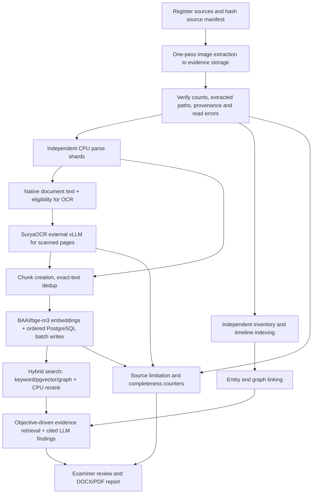
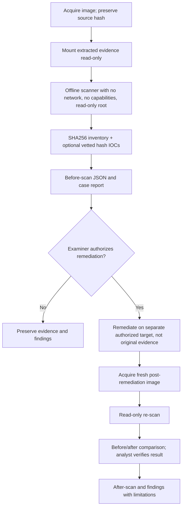

# Polaron host-AI, SuryaOCR, forensic RAG and malware isolation update

**Version:** 2026-11-09 · **Scope:** uploaded `polaron2(9).zip` · **Status:** code and offline tests completed; deployment and 100 GB benchmark **not run** on examiner hardware.

## 1. Files changed or added

| Area | Files | Result |
|---|---|---|
| Host LLM | `docker-compose.yml`, `docker-compose.https.yml`, mobile Compose files, `backend/app/config.py`, `backend/app/services/ollama_model_plan.py` | Removed Ollama/Ollama-init service dependencies, use host Ollama, select only declared installed models; `host.docker.internal` bridge; no model auto-pull in Compose. |
| OCR | `backend/requirements.txt`, `backend/app/services/surya_adapter.py`, `backend/app/services/ocr_gpu.py` | SuryaOCR 2.5 client + external vLLM URL, typed failure on missing backend, no placeholder PDF text, correct engine provenance. |
| RAG | `backend/app/services/dual_rag_index.py`, `backend/app/retrieval/rerank.py`, `backend/app/services/image_embed.py` | Full-corpus BGE embedding enabled (including host-capacity planner), ordered database writes with bounded concurrent CPU page preparation, exact duplicate reuse, cross-encoder shortlist, no synthetic CLIP vectors. |
| Models | `download_models.py`, `scripts/setup_host_ai.ps1`, `scripts/setup_host_ai.sh`, `scripts/check_host_ai.py` | Scripted three HF downloads, Ollama inventory diagnostics; cache sharing to Docker. |
| Malware | `services/mobile-malware/docker-compose.yml`, `scripts/offline_malware_scan.py`, `docker-compose.malware-offline.yml` | Hardened malware container mounts/caps; optional isolated read-only passive hash/IOC scan and comparison after remediation. |
| Regression tests | `backend/tests/test_host_ai_rag_offline_v1.py` | Seven tests of OCR parsing and endpoint validation, read-only scanning, compose semantics and exact dedup. |

**Do not overwrite an existing `.env` with `.env.example`**. Diff and merge settings while retaining the examiner's existing passwords, case IDs and server mappings. The delivered archive intentionally excludes the existing runtime `.env`, private key material (apart from explicitly synthetic test fixtures), and transient caches.

## 2. Model inventory and responsibilities

- **Host Ollama (TCP 11434)**: `qllama/bge-reranker-v2-m3:latest`, `CyberCrew/notmythos-8b:latest`, `xploiter/the-xploiter:latest`, `mistral:7b`, `llama3.2:3b`, `deepseek-r1:8b`, `gemma2:27b`, `qwen2.5:14b`, `qwen3-coder:30b`, `nomic-embed-text:latest`.
- **Embedding**: `BAAI/bge-m3`, 1024-dimension semantic text vectors, 64K-character configurable source cap; previously a shorter cap discarded useful artifact text.
- **Image**: `sentence-transformers/clip-ViT-B-32`, 512-dimension image/text vectors. No pseudo-random vectors if the model fails.
- **Reranking**: `cross-encoder/ms-marco-MiniLM-L-6-v2`, CPU, candidate top-48 by default; keeps the main GPU available for evidence processing.
- **Forensic report drafts**: `qwen2.5:14b`; reasoning review `deepseek-r1:8b`; quick steps `llama3.2:3b`; gap-report `mistral:7b`. The dynamic capacity plan can choose `mistral:7b` for smaller GPUs. Large 27b/30b models remain installed but must not be loaded concurrently on a 12 GB card. Unverified specialized models are not invoked in evidence analysis by default.
- **Visual OCR**: Surya-ocr 2.5 model served separately through vLLM (TCP 8000). GLM-OCR has been removed from application routing and model downloads. OCR_ENGINE accepts `surya` or `tesseract` only.
- **Scene description**: SuryaOCR recognizes visible text; it is not a scene-captioning model. To produce deep image/video descriptions, separately configure and validate a vision-capable model with `FORENSIC_MEDIA_VISION_MODEL`. Otherwise the media description check is blocked rather than inventing observations. CLIP retrieval remains available.

Ollama model names are identifiers, **not proof** each model is present. Use `ollama list` and `scripts/check_host_ai.py`. GLM-OCR must not be pulled for this deployment.

## 3. Examiner workstation install (Windows 11 / PowerShell)

Run from the extracted Polaron root:

```powershell
# When Python is missing:
winget install -e --id Python.Python.3.12
# Close and reopen PowerShell after installation.
py -3.12 --version

# Install only in a dedicated host environment, separate from production workers.
py -3.12 -m venv .venv-host-ai
.\.venv-host-ai\Scripts\python.exe -m pip install --upgrade pip
.\.venv-host-ai\Scripts\python.exe -m pip install sentence-transformers transformers torch torchvision pillow
.\.venv-host-ai\Scripts\python.exe download_models.py --cache-dir .\backup\huggingface

ollama --version
ollama list

# Check host services; Python itself needs localhost, Docker needs host.docker.internal.
$env:OLLAMA_BASE_URL='http://localhost:11434'
$env:SURYA_INFERENCE_URL='http://localhost:8000/v1'
.\.venv-host-ai\Scripts\python.exe scripts\check_host_ai.py
```

The provided `scripts/setup_host_ai.ps1` can check installed models and download missing models when launched with `-PullMissing`. The `-LargeModels` switch opts in to extra-large model downloads. Installing models can consume tens of GB of disk space. `download_models.py` does not modify evidence and uses CPU to populate the Hugging Face cache. If `AETHERIS_BACKUP_DIR` is customized, supply the matching cache path, or copy the populated cache to `${AETHERIS_BACKUP_DIR}/huggingface` before starting workers.

**Ollama host access:** On Docker Desktop, containers resolve `host.docker.internal`, but the host server must listen on an interface they can reach. Configure `OLLAMA_HOST` and restart Ollama on the host; allow port 11434 **only from the trusted Docker/host path**. Never expose it publicly. Running Ollama and Surya simultaneously on a 12 GB display GPU is an OOM risk; benchmark with one major GPU model at a time or use a separate GPU for vLLM.

## 4. SuryaOCR 2.5 server and container wiring

The Surya client ships in the backend image (`surya-ocr>=0.23,<0.25`). **Use a separate Linux/WSL2 environment for vLLM**, because Surya and vLLM require incompatible pinned OpenCV versions. Native Windows vLLM installation is not a supported assumption. Follow the official Surya 2.5 inference instructions for the NVIDIA driver/CUDA/vLLM version, then serve `datalab-to/surya-ocr-2.5` with an OpenAI-compatible endpoint on TCP 8000. Configure model context length and GPU memory based on available VRAM; do not start a second vLLM server automatically from the Surya client.

**Host Linux example (only after validated vLLM installation):**

```bash
# Inside a Linux environment dedicated to vLLM, NOT the Surya client environment.
vllm serve datalab-to/surya-ocr-2.5 --host 0.0.0.0 --port 8000 --max-model-len 24576
curl -f http://127.0.0.1:8000/v1/models
```

Use host-level firewall rules to limit access to 8000. Surya's model and vLLM memory usage must fit on the real GPU; on 12 GB VRAM, lower the workload or move vLLM to a separate GPU/VM rather than assuming concurrent BGE, Ollama and Surya will work.

Merge into the real `.env` (these URLs are **container** addresses):

```dotenv
OLLAMA_BASE_URL=http://host.docker.internal:11434
SURYA_INFERENCE_BACKEND=vllm
SURYA_INFERENCE_URL=http://host.docker.internal:8000/v1
SURYA_INFERENCE_PARALLEL=4
SURYA_PAGE_BATCH=4
OCR_ENABLED=true
OCR_ENGINE=surya
OCR_MAX_PAGES=8
RAG_EMBEDDING_ENABLED=true
RAG_BACKGROUND_AFTER_BASELINE=true
RAG_EMBEDDING_MODEL=BAAI/bge-m3
RAG_IMAGE_EMBED_ENABLED=true
RAG_IMAGE_EMBED_MODEL=sentence-transformers/clip-ViT-B-32
RAG_RERANK_ENABLED=true
RAG_RERANK_DEVICE=cpu
RAG_CPU_PREP_WORKERS=4
RAG_CPU_PREFETCH_PAGES=2
RAG_DB_FETCH_BATCH=1000
RAG_SOURCE_MAX_CHARS=65536
PIPELINE_SEQUENTIAL_AGENTS=false
```

`OCR_MAX_PAGES=8` remains a **resource budget**, not a guarantee all pages were OCR'd. For complete OCR, validate unlimited/broader page processing and record page coverage in final case quality review. If Docker cannot reach a service inside WSL2, do not assume `localhost` works from inside the container; set `SURYA_INFERENCE_URL` to the actual firewall-restricted address reachable from the container. Check service reachability before starting a new case:

```powershell
docker compose exec api python -c "import urllib.request; print(urllib.request.urlopen('http://host.docker.internal:8000/v1/models', timeout=5).status)"
```

The optional `scripts/check_host_ai.py` can also be run on Windows with the host Python interpreter, or inside a container if the file is explicitly mounted there.

## 5. Forensic pipeline — dependencies within a case, concurrency between lanes



**Scheduling rule:** case artifact `n` needs its own parsed/OCR text before `n` can be embedded, but unrelated artifact `n+1` can be prepared on another CPU worker. A single PostgreSQL Session is never passed to page-preparation threads. GPU embedding and SQL writes stay deterministic and ordered; different case queues (disk/mobile/vuln/malware) retain their isolation. Stage locks prevent duplicated submissions and GPU collisions. `PIPELINE_SEQUENTIAL_AGENTS=false` allows the existing stage-aware supervisor to overlap independent jobs; it is **not** permission to finalize incomplete cases.

**Eliminated or guarded duplication:**

1. Embed identical text **only** when the text matches exactly. The previous reuse rule accepted a substring and could attribute the wrong semantic vector to a distinct artifact. Store provenance for each row even when vector computation is reused.
2. Preload the three HF models once on persistent storage shared with the workers; avoid repeated downloads/rebuilds per container.
3. Disable the old Docker Ollama and Ollama-init boot/pull cycle; an on-host `ollama list` confirms available model names.
4. Surya client batches attach to a running vLLM server instead of spawning one per OCR worker. Model or server failure is surfaced, not written as invented text.
5. CPU chunk preprocessing uses two concurrent, bounded pages by default. GPU batches retain source ordering and commit once per fetched page; no SQLAlchemy Session shared across threads.
6. Image similarity never uses pseudo-random fallback vectors. A missing CLIP model becomes an explicit unindexed state.
7. Existing single-pass extraction / manifest dedup is preserved. A live database replay and artifacts-per-file comparison are still required to prove that production agents don't issue duplicate jobs under failure/retry.

## 6. Evidence retrieval and indexes

The existing product uses PostgreSQL `rag_chunks` keyed to `job_id` and `file_path`, `artifact_parse_results` keyed to `job_artifact_id`, `ocr_results` keyed to source artifact, plus image embeddings keyed to image SHA/model. Query patterns must always restrict the case/tenant and preserve `job_artifact_id`, source path, image segment, OCR engine and time provenance. Use hybrid keyword/vector retrieval with CPU cross-encoder reranking; never treat LLM-generated text as original evidence.

Before introducing another index, review `pg_stat_user_indexes` and `pg_stat_statements` (when enabled), and run `EXPLAIN (ANALYZE, BUFFERS)` on actual artifact, timeline and retrieval queries. **No speculative new production index or migration was added** because real row distributions and table definitions differ between tenant schemas.

## 7. Isolated, non-executing malware inspection

The existing mobile-malware pipeline includes ClamAV, YARA, static app checks, findings, consent-gated Android remediation and before/after report support. The new optional helper is a read-only passive **disk evidence hash scan**, not a replacement for those analysis engines.



Example on **Docker with acquired evidence**, not on the examiner's live system directory:

```powershell
$env:MALWARE_EVIDENCE_DIR='D:/Evidence/Case-01-extracted-copy'
$env:MALWARE_REPORT_DIR='D:/ForensicReports/Case-01'
# Create the report directory and limit write permission to the scanner UID.
docker compose -f docker-compose.malware-offline.yml run --rm scanner
# After authorized remediation, point MALWARE_EVIDENCE_DIR to a NEW, acquired copy:
docker compose -f docker-compose.malware-offline.yml run --rm scanner scan --source /evidence --output /reports/after.json
# Compare both reports; the result never asserts successful removal automatically:
docker compose -f docker-compose.malware-offline.yml run --rm scanner compare --before /reports/before.json --after /reports/after.json --output /reports/comparison.json
```

The container is configured with no network, all Linux capabilities removed, no privilege escalation, read-only filesystem, private noexec tmpfs and **read-only evidence bind**. Report directory access requires appropriate permissions for UID 65534. On Docker Desktop, verify ACLs and mounted volumes before scanning. Neither script nor container executes/decompresses unknown samples. Match against analyst-supplied SHA-256 IOCs using optional `--indicators /reports/known-bad-hashes.txt` lines (`sha256 label`). Do not infer clean status from a zero-match report.

**Risk statement:** Docker containers still share a kernel and cannot eliminate every exploit risk. For dynamic malware analysis or suspicious archive extraction, use an isolated offline VM, nonpersistent snapshots, no shared folders/clipboard, no host credentials, controlled sample transfer and no outbound network by default. Never detonate malware on the examiner laptop.

The existing mobile remediation endpoint is distinct: it must require authorization and consent, record the pre-remediation scan and hashes, only change specifically approved device items, then re-acquire/re-scan and preserve the earlier report. Merely finding a suspicious sample is not authorization to delete it. The new passive scanner performs **no removal**.

## 8. Performance goal and measurable exit criteria

**Goal:** process a 100 GB image within 90 minutes (5400 s) including artifact extraction, document parsing/OCR, searchable embeddings, graph linking and report preparation. This requires **at least 18.5 MB/s just to read 100 GB once**, ignoring image decompression, hash/checksum reads, SQL writes, network storage, model load, OCR and report creation. Scanned multi-page PDFs and hundreds of thousands of small artifacts can make 90 minutes unattainable on a single 12 GB card.

Suggested metrics per run: physical bytes read/written; evidence files discovered/extracted/skipped/failed; parse results and failures; OCR-eligible pages and processed/skipped/failed counts; `rag_chunks` and CLIP vectors; model cache miss/load times; GPU VRAM/temperature; PostgreSQL waits and insert/commit p95; query retrieval p95; report build time; source limitations. A 100% *processing state* means all attempted tasks have terminal statuses, **not** full evidentiary coverage.

Read stage timelines for a real case (replace the UUID and tenant search_path as needed):

```sql
SELECT stage, status, total_items, completed_items, failed_items, skipped_items,
       started_at, completed_at,
       EXTRACT(EPOCH FROM (completed_at - started_at)) AS elapsed_seconds
FROM pipeline_stage_runs
WHERE job_id = 'REPLACE-WITH-CASE-UUID'::uuid
ORDER BY sequence_no;
```

Pass conditions: no integrity hash mismatches, no double-counted source paths without distinct source offsets, no fabricated text or vectors, no unreported OCR limits, no lost retryable tasks, bounded RAM/GPU usage, no scanner impact on the evidence mount, no undocumented retrieval/model failures, independently reviewed before/after malware findings, and reproducible reports with citations.

## 9. Validation performed and remaining deployment steps

- **Passed here:** `python -m pytest -q backend/tests/test_host_ai_rag_offline_v1.py backend/tests/test_ollama_model_plan.py` (11 focused tests: seven new forensic safety/RAG/OCR checks plus four updated model-inventory checks); Python compilation of modified modules; `bash -n` setup scripts; PyYAML parsing and dependency checks of the seven updated Compose files.
- **Attempted but not completed here:** `python download_models.py` — missing `sentence_transformers` and `transformers` in this environment. A broader existing test run also could not complete because this sandbox lacks `psycopg2`, `celery` and `zstandard`; those tests are **not** reported as passing. This sandbox does not contain the user's Ollama installation/GPU, a running Surya vLLM service or a production PostgreSQL case.
- **Not claimed:** verified vLLM/Python dependency resolution in the full Docker image, end-to-end disk/mobile/vulnerability/malware service boot, actual forensic RAG report generation, sample malware detonation/removal, a production 100 GB benchmark, or a guaranteed 90-minute SLA.
- **Required on examiner host:** back up the original deployment, merge `.env.example`, install models in a persistent cache, start/check the host services, build the backend image, `pip check`, run the regression suite, verify `docker compose config`, run a small synthetic case first, then execute a recorded 100 GB benchmark before signoff.

### Security and licensing

Surya's source code has Apache 2.0 licensing, but the model weights have a separate modified AI Pubs Open Rail-M license with commercial restrictions; confirm eligibility/licensing before deployment in a commercial forensic service. Do not send confidential evidence to external reputation services unless legal authority and case policy allow it. `MALWARE_ONLINE_REPUTATION=false` is the intended offline setting; treat third-party IOC updates as separate signed/verified imports.

## Surya-only transition (November 10, 2026)

GLM-OCR was removed from Ollama pull lists, Hugging Face prefetch, OCR routing, local model loading, GPU cleanup and live OCR acceptance. Existing case evidence and archived release notes are preserved. The prior GLM-specific test module was retired; new offline Surya regression tests cover engine validation, ordering, wrong batch sizes, server failures, timeouts and Tesseract selection. Use `python scripts/migrate_surya_only_env.py --env .env` first (dry run), then `python scripts/migrate_surya_only_env.py --env .env --apply` to preserve secrets and create a backup while updating old OCR settings. A standalone vision description requires explicit configuration and is not silently substituted by OCR.
