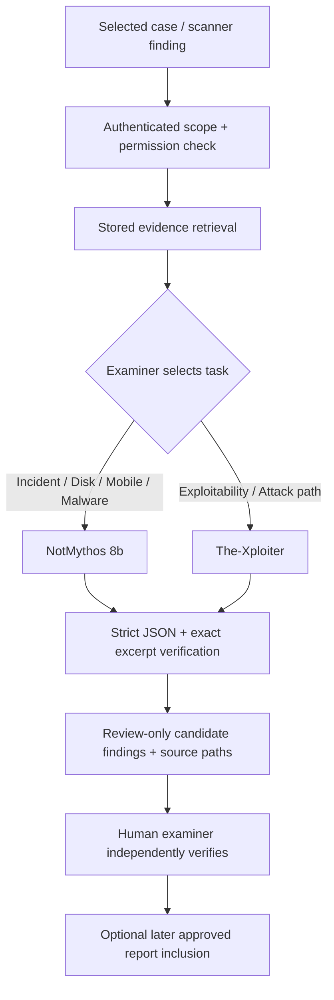

# Polaron Specialist Models — Implementation and Validation (2026-11-10)

## Updated source
Base: `polaron2_multi_directory_sequential_20261110.zip`, preserving shared Common Docker, Polaron-only Neo4j, host Ollama, SuryaOCR, single-case multi-directory sequential extraction/merge barrier, and existing forensic, vulnerability, mobile, malware, RAG and reporting components.

## Implementation

1. `backend/app/config.py` — new environment-backed specialist roles and resource/time limits.
2. `backend/app/services/model_router.py` — expose installed-model health for both specialist roles, with exact case-insensitive model-name matching.
3. `backend/app/services/forensic_specialists.py` — new read-only on-demand specialist service: NotMythos for disk/mobile incident and malware behavior; The-Xploiter for scanner exploitability and conditional attack-path assessment. Evidence bounded to 8 retriever hits/12K chars by default; zero-temperature structured JSON; separate fail-closed results for unavailable model, insufficient evidence, invalid JSON, load contention, and Ollama error. Discard every finding lacking a source ID and an exact quoted substring. Preserve original chunk ID and source path, require examiner verification, explicitly false for `actions_performed` and `remediation_verified`.
4. `backend/app/routers/retrieval.py` — authenticated `POST /api/jobs/{job_id}/specialist/analyze`, uses the existing permission `artifact:read`, verifies the job in the firm's database scope, retrieves case-scoped RAG evidence, writes stage audit metadata, and never executes forensic commands or changes evidence. Supports task types `incident_analysis`, `disk_security`, `mobile_security`, `malware_behavior`, `vulnerability_exploitability`, `attack_path_review`.
5. `backend/app/routers/vuln.py` — authenticated `POST /api/cases/{case_id}/vulnerabilities/{finding_id}/specialist`, checks `vuln:read` and existence of scanner findings inside exactly that case, uses actual database finding fields as evidence, and writes a scanner audit event. No active exploitation or network scanning.
6. Frontend: `RagQaPanel.tsx` adds analyst-selected task/model and an explicit specialist action; `MobileRagPanel.tsx` adds an on-demand NotMythos action; vulnerability explorer adds an on-demand The-Xploiter action for selected stored findings, each showing source-quoted candidate observations and limitations.
7. Frontend API client functions and `.env.example` updated.

## Host installation

These are separate Ollama models. On the same Windows/Ubuntu host running Ollama, execute:

```bash
ollama pull CyberCrew/notmythos-8b:latest
ollama pull xploiter/the-xploiter:latest
ollama list
```

Run host Ollama and ensure it is reachable by the Docker services at `http://host.docker.internal:11434`. Restart Polaron after setting the environment. To disable either specialty, set its corresponding enable flag to false.

```env
FORENSIC_SPECIALIST_ENABLED=true
VULNERABILITY_SPECIALIST_ENABLED=true
FORENSIC_SECURITY_MODEL=CyberCrew/notmythos-8b:latest
VULNERABILITY_REASONING_MODEL=xploiter/the-xploiter:latest
AI_SPECIALIST_TIMEOUT_SEC=120
AI_SPECIALIST_MAX_CONCURRENT=1
AI_SPECIALIST_MAX_EVIDENCE_CHARS=12000
```

The application does **not** preload either specialist or run it on all artifacts: select an action from RAG Q&A, mobile RAG, or a stored vulnerability finding. Because of the 12 GB VRAM target and SuryaOCR/embedding contention, model inference is serialized per backend worker process; multi-process GPU limits and actual VRAM admission still need on-machine testing. Only model installation is on host; Common Docker has not been modified.

## Data / evidence control

Models are **text reasoning assistants**. The code never treats model output as verified forensic evidence. Every candidate requires an exact substring quote in a retrieved evidence excerpt; unverifiable entries are discarded. A matching quote does **not** prove a model's logical interpretation, so examiner verification remains mandatory. Case-specific retrieval/auth boundaries are enforced in API routes. The raw model text and evidence content are not written to audit logs; audit metadata records task, model, accepted/rejected counts and status.

The two specialists do not directly alter case records, append reports, trigger scans, test vulnerabilities, decrypt protected evidence, execute suspicious files, remediate devices, or edit original evidence. They return **review candidates** that can be incorporated into an examiner-approved report manually; automatically promoting candidates to findings/reports would need a separate approval and persistence workflow.

## Test evidence and limitations

- **40 focused backend tests passed** from `backend/` (`PYTHONPATH=. python -m pytest -q tests/test_forensic_specialists_v1.py tests/test_ollama_model_plan.py tests/test_host_ai_rag_offline_v1.py tests/test_multi_directory*`), including nine new specialist tests.
- All changed Python modules compile (`python -m compileall`).
- Five changed TypeScript/TSX files had zero parser diagnostics using global TypeScript 5.x.
- Full frontend `npm ci --offline` could not run because the cached `yallist` archive was absent; thus the full React production build remains **unverified**.
- Docker Compose deployment, live host Ollama model responses, service-to-service routing, production PostgreSQL audit writes, GPU thermal behavior, model quality/accuracy, scanner correctness, and final report appearance remain **unverified** in this environment.
- A matching quoted substring is a necessary *but not sufficient* grounding check; model-derived judgments may still be wrong. The Xploiter must not be used to run active exploits autonomously.

## Flow



## Deployment precautions

Back up existing PostgreSQL and `.env` before deploying changes. The distributed ZIP intentionally excludes `.env` and any private keys. Preserve original shared Docker volumes, Neo4j, and source evidence. Install requested Ollama models separately and check `GET /api/health` / existing model-health endpoint before usage. Do not interpret missing specialist findings as the absence of compromise. No changes were made to the multi-directory extraction gating or evidence ownership rules.
